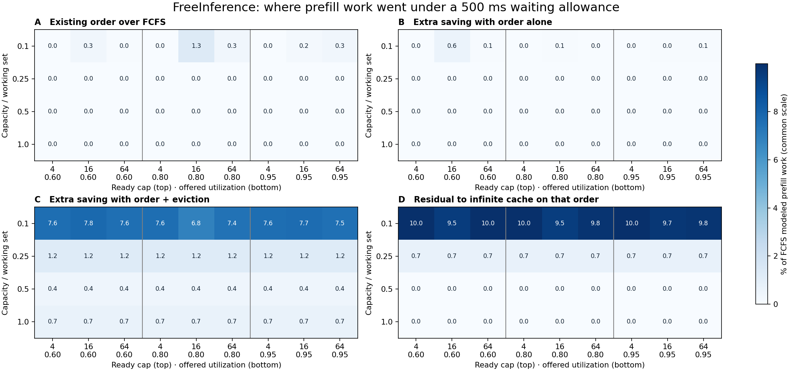

# When does request order matter for prefix reuse? CPU pilot decision

**Stop before GPU validation.** On 3,000 held-out FreeInference coding/assistant requests, none of the 36 primary configurations saved the registered 3% of modeled prefill service work through ordering alone. Nine configurations did qualify when the reference could also change eviction, but the predictor flagged all 36: 9 true positives, 27 false positives, **25% precision**, below the required 80%. Both decision rules say no. This pilot did not run a GPU, measure SGLang latency, or reopen the previous evaluator report.

**What changed the work.** Each percentage below is relative to FCFS under exactly that cell's capacity, arrivals and service budget. Maxima can occur in different cells; do not add them across rows. The right column is descriptive, not another opportunity to pass.

| Held-out result | W = 500 ms (primary) | W = 2 s (sensitivity) |
|---|---:|---:|
| Largest saving by an existing ordering over FCFS (G1) | 1.261% | 1.344% |
| Largest further saving by the future-informed reference holding LRU fixed (G2 order) | 0.591% | 0.699% |
| Largest further saving when the reference could also change eviction (G2 mixed) | 7.765% | 7.626% |
| Largest residual above infinite cache on the same chosen order (G3) | 9.989% | 9.978% |
| Material cells: ordering only / literal mixed rule | 0 / 9 of 36 | 0 / 9 of 36 |

All nine joint positives occurred at 10% of the calibration working set (402 retained blocks): 6.846–7.765% mixed savings across all three utilizations and ready caps. No larger-capacity cell passed. At 60% utilization and cap 16 in this small-cache regime, the future-informed LRU order saved an extra **0.591 percentage points** over the best online ordering. **Keeping exactly that order** and changing only eviction saved another **7.174 points** (FCFS denominator). This is a direct attribution on one matched order. It is an offline, future-informed eviction result, not evidence of a deployable eviction policy. G3 measures the cost of finite retention on that reference order; no global optimum was established. The best complete LRU trajectory of any kind saved at most 1.323% over FCFS in the primary grid.

**Prediction.** The fixed threshold learner saw no positive ordering-only cells in the 72 primary Mooncake development configurations and selected “flag none”; all 72 qualified by the joint criterion, so its joint rule selected “flag all”. k=2 won the predeclared tie with k=4. Neither rule learned a discriminating threshold. The Qwen traces were secondary checks, not fit data. Following the predeclared primary rule literally, precision is undefined for ordering alone (zero flags); for the mixed rule precision was 25% and recall 9/9. The association with the smallest capacity was learned from this exposed holdout and **is not** a validated predictor.

| Development workload (500 ms) | Ordering-only material | Joint material |
|---|---:|---:|
| Mooncake conversation | 0/36 | 36/36 |
| Mooncake tool/agent | 0/36 | 36/36 |
| Qwen chat (secondary) | 0/36 | 36/36 |
| Qwen API (secondary, separate lineage per request) | 0/36 | 0/36 |

**The queues did fill.** All three ready caps were reached in every corresponding held-out cell. At cap 64, mean ready depth was 21.5–43.7; the FCFS shadow saw all 64 requests at 25.3–53.9% of dispatches. Holding the cache fixed and permitting a two-second delay still produced no material ordering cell. The certified waiting guard was conservative: across the primary LPM, selected k-LPM and DFS trajectories, 3,063 of 9,220 proposed group reorderings were accepted (6,157 vetoed). These are counts over repeated grid settings, not distinct requests. The worst additional start delay among tested LRU schedules was 499.092 ms. A different guard could allow other legal orders; the small attained gains are not an upper bound.

**What the latency numbers can support.** The bound is on the delay *relative to FCFS start*, not on absolute TTFT. With one modeled prefill stream and rescaled arrivals, FCFS median TTFT spanned 10.5–319.5 seconds and p99 spanned **37.0–44.3 minutes**. In the primary grid the best online ordering changed modeled p99 by at most 0.0034% in absolute relative terms. These are simulator outputs, not production service levels. The frozen H100 coefficients (ms) were a=5.30609, b=0.0130596 per uncached token, c=1.00860e−6 per uncached token × context token. The published SGLang kernel measurements were cold, batch-one measurements. The reserved cold points differed from the fitted curve by up to 13.2%; 2,304 of the 3,000 measured prompts (76.8%) exceeded the longest calibrated 16,384-token point; 1,855 exceeded the reference model's standard 40,960-token context. No end-to-end or cached-extension fit was validated. This is grounds to withhold a GPU-latency claim, not grounds to loosen a failed gate. At 72 MiB per 512-token block for these BF16 dimensions, the four retained pools alone correspond to 28.3, 70.7, 141.3 and 282.7 GiB before weights or workspace. The top settings are virtual pressure comparisons. Shapes, prefix horizons, user namespace, finite windows and this one held-out period limit generalization.

**Integrity and scope.** The experiment froze at 18:28:06 UTC. Each source supplied 2,000 shared warm-up and 3,000 measured requests. We verified the 75,971,550-byte author-published [FreeInference object](https://huggingface.co/datasets/harvardMadsys/2026_prefixcache/tree/ba89a343a048073dda72617bb6087910da6214d0) by SHA-256 and inspected its full 327,548-record frame to select the first 5,000 by arrival rather than completion. The 3,000 measured requests span 4.47 hours of original arrivals. The predictor and all 36 flags were saved and hashed before the single scoring pass. Across the four development traces and one holdout, 360 workload configurations were scored including the waiting sensitivity. An independent ordered-dictionary replay of saved holdout witnesses reproduced the order accounting, token counts, steps and median/p99, and checked all **540,000 primary starts** across 180 LRU trajectories with zero waiting-limit, membership, precedence or ready-cap violations. Numerical execution, preparation in the run and audit used 363.5 CPU seconds (267.8 s elapsed). No second holdout scoring pass or refit.

[Full 72-cell table](heldout_grid.md) · [Held-out per-policy outcomes](raw/freeinference.scores.jsonl) · [Development cells](development_cells.json) · [Frozen design](protocol.md) · [Input and code hashes](freeze.json) · [Predictions made before scoring](heldout_predictions.json) · [Stage log](events.jsonl) · [Independent verification](heldout_audit.json) · [Reproduction notes](REPRODUCE.md)
